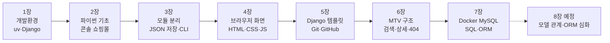

# APPWORK

SKN35 과정 **앱 개발 파트** 실습을 장(章)별로 모아 두는 저장소입니다.
교재를 따라 만든 코드와, 교재를 제 말로 다시 풀어 쓴 풀이노트를 같이 올리고 있습니다.

| 장 | 주제 | 코드 | 풀이노트 | 검증 |
|---|---|---|---|---|
| 1장 | Python 3.12 · uv · VS Code · Django 개발환경 | [chapter01_project](chapter01_project) | [MD](notes/chapter01-풀이노트.md) · [HTML](notes/chapter01-풀이노트.html) | pytest 2 |
| 2장 | Python 기본 문법과 상품 데이터 처리 | [chapter02_project](chapter02_project) | [MD](notes/chapter02-풀이노트.md) · [HTML](notes/chapter02-풀이노트.html) | pytest 8 |
| 3장 | Python 모듈·예외 처리·JSON 상품 관리 | [chapter03_project](chapter03_project) | [MD](notes/chapter03-풀이노트.md) · [HTML](notes/chapter03-풀이노트.html) | pytest 13 |
| 4장 | HTML·CSS·JavaScript 상품 웹 화면 | [chapter04_project](chapter04_project) | [MD](notes/chapter04-풀이노트.md) · [HTML](notes/chapter04-풀이노트.html) | pytest 6 + 브라우저 |
| 5장 | Git·GitHub와 Django 쇼핑몰 프로젝트 | [chapter05_project](chapter05_project) | [MD](notes/chapter05-풀이노트.md) · [HTML](notes/chapter05-풀이노트.html) | pytest 5 + Django 3 + 브라우저 |
| 6장 | Django MTV · URL · View · Template | [chapter06_project](chapter06_project) | [MD](notes/chapter06-풀이노트.md) · [HTML](notes/chapter06-풀이노트.html) | pytest 10 + 브라우저 |
| 7장 | Docker · MySQL 설치 및 SQL 기초 | [chapter07_project](chapter07_project) | [MD](notes/chapter07-풀이노트.md) · [HTML](notes/chapter07-풀이노트.html) | MySQL에서 pytest 4 + SQL 실습 + 브라우저 |



같은 "상품 목록·검색·주문"을 장마다 다른 방식으로 다시 만들어 보는 흐름이라, 한 장씩 쌓아 올리는 느낌으로 정리했습니다.

---

## 장별 회고

### 1장 · 개발환경
1장은 코드보다 **환경 세팅**이 대부분이었습니다. `uv init`, `uv venv`, `uv add`, `startproject`처럼 명령을 하나씩 치는데, 각 명령이 무슨 파일을 만들고 그 파일이 무슨 일을 하는지 머릿속에서 연결이 잘 안 됐습니다. 그래서 교재를 "이 명령 → 이 파일 → 이 역할"로 묶어 정리했습니다.
PowerShell 실행 정책을 다섯 번 넘게 바꿨는데, 한 번만 하면 계속 유지된다는 걸 나중에 알았습니다.

### 2장 · 파이썬 기본 문법
변수·조건·반복·함수를 상품 데이터 하나로 연습했습니다. 돈 계산을 실수 대신 정수와 `//`로 하는 이유, 할인율은 `Decimal`로 받는 이유를 처음 제대로 이해했습니다.
가장 인상 깊었던 건 주문 함수에서 **모든 검사를 통과한 뒤에만 재고를 깎는 순서**였습니다. 할인율이 잘못됐는데 재고부터 줄이면 주문은 실패했는데 재고만 사라지는 버그가 생기고, 테스트 하나가 정확히 그걸 잡고 있었습니다.

### 3장 · 모듈과 JSON
2장 코드를 `cli → service → repository` 세 층으로 나눴습니다. 처음엔 파일만 늘어난 것 같았는데, "JSON을 나중에 MySQL로 바꿀 때 repository만 고치면 된다"는 말을 듣고 나서 왜 나누는지 납득이 됐습니다.
`order` 후 다시 `list`를 하면 재고가 그대로 남아 있는 걸 보면서, 2장(끄면 사라짐)과 3장(파일에 남음)의 차이를 몸으로 느꼈습니다.

### 4장 · 브라우저 화면
파이썬 없이 HTML·CSS·JS만으로 상품 카탈로그와 장바구니를 만들었습니다. "데이터(`cart` Map)를 바꾸고 → 화면을 통째로 다시 그린다"는 흐름이 핵심이었습니다.
pytest는 파일 구성만 보기 때문에, 검색·담기·삭제·전체 비우기와 휴대폰 폭 1열 전환은 브라우저에서 직접 눌러 보며 확인했습니다. `innerHTML` 대신 `textContent`를 쓰는 이유(XSS)도 여기서 처음 알았습니다.

### 5장 · Django 쇼핑몰과 Git
4장에서 브라우저가 만들던 화면을 이번엔 **서버가 템플릿으로 만들어 보내도록** 바꿨습니다. 1장은 `urls.py`에 함수를 바로 넣었는데, 5장부터 `shop` 앱을 따로 만들고 `include`로 연결하니 장고 프로젝트다운 구조가 됐습니다.
Git은 이미 쓰고 있었지만 `add → commit → push`가 각각 어디로 옮기는 건지 그림으로 다시 정리했습니다.

### 6장 · Django MTV
5장 구조를 제대로 나눠서 목록·검색·상세·404를 만들었습니다. `<int:product_id>`가 주소의 숫자를 꺼내 View에 넘겨 주고, `?q=` 검색어는 `request.GET`으로 받는다는 차이가 처음엔 헷갈렸습니다.
`base.html` 하나에 헤더·푸터를 두고 페이지마다 빈칸(block)만 채우는 템플릿 상속을 쓰니, 페이지가 늘어도 공통 부분은 한 곳만 고치면 됐습니다. 테스트가 화면 글자뿐 아니라 "어떤 템플릿에 어떤 데이터를 넘겼는지"까지 검사할 수 있다는 것도 새로 알았습니다.

### 7장 · Docker와 MySQL
SQLite를 MySQL로 바꾸는 장인데, MySQL을 PC에 직접 깔지 않고 Docker 컨테이너로 띄운다는 게 처음엔 낯설었습니다. 이미지(틀) · 컨테이너(실행 중인 것) · 볼륨(데이터 보관) · 포트 연결, 이 네 개로 정리하고 나서야 `compose.yaml`이 읽혔습니다.
처음엔 PC에 Docker가 없어서 DB만 SQLite로 바꿔 끼운 임시 설정으로 코드부터 확인했습니다. 그다음 Docker Desktop을 설치하려는데 계정에 관리자 권한이 없어 WSL 설치가 막혔고, 관리자 PowerShell에서 `wsl --install`을 두 번 돌리고 재부팅하고 나서야 엔진이 떴습니다.
막상 MySQL을 띄우니 교재대로는 안 되는 게 네 가지나 나왔습니다. 한글이 `노트ë¶`으로 저장됐고(컨테이너 클라이언트가 latin1), 연습용 SQL이 첫 실행 때 자동으로 돌아 마우스 재고가 29로 시작했고, pytest는 테스트 DB 권한이 없어 전부 실패했습니다. 로그와 저장된 바이트를 하나씩 확인해서 고쳤고, 볼륨을 지우고 처음부터 다시 띄워도 그대로 되는 것까지 확인했습니다.

---

## 교재대로 했는데 막혔던 것

| 장 | 증상 | 원인 | 해결 |
|---|---|---|---|
| 1 | `KeyError: 'DJANGO_SECRET_KEY'` | PowerShell 5.1의 `Set-Content -Encoding utf8`이 `.env` 앞에 BOM을 붙여 키 이름이 `DJANGO_SECRET_KEY`가 됨 | BOM 없이 저장 (`[IO.File]::WriteAllLines`) |
| 1 | `UnicodeDecodeError: 'cp949'` | hello.py는 UTF-8로 출력하는데 테스트가 한글 Windows 기본값 cp949로 읽음 | `subprocess.run(..., encoding="utf-8")` |
| 2 | `ModuleNotFoundError: No module named 'catalog'` | 교재 `pyproject.toml`에 `pythonpath` 설정이 없음 | `pythonpath = ["."]` 추가 |
| 2 | 테스트가 `shop`을 못 찾음 | 받은 zip의 파일 이름이 `09_shop.py` | 교재대로 `shop.py`로 변경 |
| 3 | `exercises/solutions.py` 실행 시 `catalog` 없음 | 파이썬은 실행한 파일의 폴더(`exercises/`)만 경로에 넣음 | 2장 `answers.py`처럼 `sys.path.insert` 추가 |
| 4 | zip에 pytest 개발 의존성 없음 | 교재의 `uv add --dev` 단계가 zip에 미반영 | `uv add --dev "pytest>=8,<10"` |
| 5 | `verify.ps1` 마지막 줄이 `NO TESTS RAN` | `unittest discover`가 pytest 함수형 테스트를 못 찾음 | `uv run pytest -v`로 변경 |
| 6 | `verify.ps1`의 "제6장 검증 완료"가 깨져 나옴 | PowerShell 5.1은 BOM 없는 UTF-8 스크립트를 cp949로 읽음 | `.ps1`을 BOM 있는 UTF-8로 저장 (5장도 같이) |
| 7 | 화면에 CSS가 안 입혀짐 (`findstatic`: No matching file found) | CSS가 프로젝트 루트 `static/`에 있는데 `STATICFILES_DIRS` 설정이 없음 | `STATICFILES_DIRS = [BASE_DIR / "static"]` 추가 |
| 7 | 초기 데이터 한글이 `노트ë¶`으로 저장됨 | 컨테이너 mysql 클라이언트 기본 문자셋이 latin1 | SQL 파일에 `SET NAMES utf8mb4;`, 접속 시 `--default-character-set=utf8mb4` |
| 7 | 첫 실행부터 마우스 재고 29 | `sql/` 바로 아래 `.sql`은 전부 자동 실행 → 연습용 UPDATE까지 적용 | `sql/practice/03_queries.sql`로 이동 |
| 7 | pytest 4개 `Access denied … 'test_shopdb'` | MySQL 이미지는 앱 계정에 `shopdb` 권한만 줌 | `sql/03_test_privileges.sh`로 첫 실행 때 권한 자동 부여 |

직접 낸 실수(`cd . 경로`, `--python3.12`, `..venv`, 교재의 `PS>`까지 복사)는 [1장 풀이노트](notes/chapter01-풀이노트.md#제가-실제로-낸-실수들)에 정리했습니다.

## 배운 점
- **uv 하나가 pip + venv + 파이썬 버전 관리를 다 한다.** `pyproject.toml`은 장보기 목록, `uv.lock`은 영수증, `.venv`는 실제로 설치된 곳입니다. uv가 `.venv`를 캐시와 하드링크로 공유한다는 것도 디스크 정리를 하다가 알게 됐습니다.
- **역할을 나누면 바꾸기 쉬워진다.** 2장 단일 파일 → 3장 계층 분리 → 5장 프로젝트/앱 분리로 갈수록, 고칠 곳이 한 군데로 모였습니다.
- **테스트는 무엇을 검사하는지 알아야 한다.** 4장 pytest는 파일 구조만, 5장은 HTTP 응답까지 봅니다. 화면 동작은 결국 직접 눌러 봐야 했습니다.
- **비밀값은 코드에서 분리한다.** `.env`로 빼고, `.gitignore`로 막고, `.env.example`만 공유합니다.
- **에러 메시지의 겉모습만 믿으면 안 된다.** 교재를 그대로 따라 했는데 나는 오류가 12개였고, 대부분 한글 환경(BOM, cp949, latin1)이나 경로·권한 문제였습니다. 특히 BOM은 `.env`에서는 빼야 하고 `.ps1`에서는 넣어야 해서, "UTF-8"이라는 말만으로는 부족하다는 걸 배웠습니다.
- **Docker는 "설치된 프로그램을 상자째" 쓰는 방법이다.** DB를 PC에 직접 깔지 않아도 되고, 설정이 `compose.yaml` 파일로 남아 누구나 똑같이 띄울 수 있습니다.

---

## 실행 방법

Windows PowerShell 기준입니다. [uv](https://docs.astral.sh/uv/)가 설치되어 있어야 합니다.

```powershell
git clone https://github.com/SKN35shimsungwook/APPWORK.git
cd APPWORK
uv python install 3.12
```

### 1장
```powershell
cd chapter01_project
uv sync
Copy-Item .env.example .env
$secret = uv run python -c "from django.core.management.utils import get_random_secret_key; print(get_random_secret_key())"
$lines = (Get-Content .env) -replace '^DJANGO_SECRET_KEY=.*$', "DJANGO_SECRET_KEY=$secret"
[IO.File]::WriteAllLines("$PWD\.env", $lines)
uv run python manage.py migrate
uv run pytest -v
uv run python manage.py runserver 127.0.0.1:8000    # "Chapter 01 Django 실행 성공"
```

### 2장
```powershell
cd chapter02_project
uv sync
uv run python shop.py              # 주문: 무선 키보드 2개 / 63,000원
uv run pytest -v                   # 8 passed
uv run python exercises/answers.py
```

### 3장
```powershell
cd chapter03_project
uv sync
uv run python main.py list
uv run python main.py search 키보드
uv run python main.py order 1 2    # 재고가 data/products.json에 저장됨
uv run pytest -v                   # 13 passed
uv run python exercises/solutions.py
```
처음 상태로 돌리려면 `data/products.json`을 지웁니다.

### 4장
```powershell
cd chapter04_project
uv sync
uv run pytest -v                       # 6 passed
uv run python -m http.server 8000      # http://localhost:8000
```

### 5장
```powershell
cd chapter05_project
uv sync
uv run python manage.py migrate
uv run pytest -v                       # 5 passed
uv run python manage.py test shop      # 3 tests OK
uv run python manage.py runserver 8000 # http://127.0.0.1:8000/ , /health/
```
`.\scripts\verify.ps1` 한 줄로 위 검사를 한 번에 돌릴 수도 있습니다. 5장은 `.env`가 없어도 개발용 기본 키로 실행됩니다.

### 6장
```powershell
cd chapter06_project
uv sync
uv run python manage.py migrate
uv run pytest -v                       # 10 passed
uv run python -m exercises.solutions
uv run python manage.py runserver 127.0.0.1:8000
# http://127.0.0.1:8000/ , /?q=마우스 , /products/1/ , /products/999/ (404)
```

### 7장 (Docker Desktop 필요)
```powershell
cd chapter07_project
uv sync
Copy-Item .env.example .env            # MySQL 비밀번호와 DJANGO_SECRET_KEY 변경
docker compose up -d
docker compose ps                      # mysql이 healthy인지 확인
uv run python manage.py migrate
uv run python -m scripts.seed_products # 상품 등록 확인: 3개
uv run python manage.py runserver 127.0.0.1:8000
uv run pytest -v                       # 다른 창에서, MySQL 실행 중이어야 함
uv run python -m exercises.solutions
docker compose down                    # 끝나면 정리 (데이터는 볼륨에 남음)
```
SQL 실습은 `docker compose exec mysql sh -c 'MYSQL_PWD="$MYSQL_PASSWORD" mysql -u"$MYSQL_USER" "$MYSQL_DATABASE" --default-character-set=utf8mb4'`로 접속해서 `sql/practice/03_queries.sql`을 한 줄씩 실행합니다. Docker를 쓰려면 WSL2가 필요하고, 설치에는 관리자 권한과 재부팅이 필요합니다.

## 검증 결과 (제 PC에서 직접 실행)

| 장 | 검사 | 결과 |
|---|---|---|
| 1 | `pytest` / `check` / `runserver` | 2 passed / no issues / `GET /` 200 |
| 2 | 01~08 예제, `shop.py`, `answers.py` | 교재 출력과 모두 일치, 8 passed |
| 3 | `list → order 1 2 → list`, `order 999 1` | 재고 5→3 저장, 오류 시 종료 코드 1, 13 passed |
| 4 | 브라우저 조작 | 6개 표시 → 검색 1개 → 담기 총액 207,000원 → 삭제 → 비우기 0원, 375px에서 1열 |
| 5 | `check` / `pytest` / `test shop` / 브라우저 | no issues / 5 passed / 3 OK / 카드 3개·품절 표시·`/health/` ok |
| 6 | `check` / `pytest` / `verify.ps1` / 브라우저 | no issues / 10 passed / "제6장 검증 완료" / 목록 3개·`?q=마우스` 1개·상세·`/products/999/` 404 |
| 7 | `compose up` / SQL 실습 / `migrate`·시드 / `pytest` / 브라우저 | 35초 만에 healthy / CRUD·집계(3종류, 재고 46) / shop_product 생성·3개 등록 / MySQL에서 4 passed / 상품 표·CSS 200·`/admin/login/` 200 |

---

## 기술 스택

| 항목 | 버전 |
|---|---|
| OS | Windows 11 · PowerShell 5.1 |
| Python | 3.12.x (uv 관리) |
| 패키지 관리 | uv |
| 웹 | HTML · CSS · JavaScript (4장), Django 5.2.7 (1·5~7장) |
| 환경변수 | python-dotenv 1.1.1 |
| 테스트 | pytest 8~9, pytest-django 4.8~ |
| DB | MySQL 8.4 (Docker 컨테이너, 7장) · mysqlclient 2.3 |
| 데이터 | 메모리(2장) → JSON 파일(3장) → SQLite(1·5·6장) → MySQL(7장) |

## 폴더 구조

```
APPWORK/
├── README.md
├── notes/                         # 장별 풀이노트
│   ├── chapter01~07-풀이노트.md     # GitHub에서 바로 읽는 버전 (mermaid 그림)
│   └── chapter01~07-풀이노트.html   # 내려받아 브라우저로 여는 버전
│                                  #   그림·파일 탐색기·확인 문제·점검표, 장 사이 이동 링크
│                                  #   4장은 장바구니를 직접 눌러 보는 체험판 포함
├── chapter01_project/             # Django 개발환경 (config/, hello.py, tests/)
├── chapter02_project/             # 01~08 문법 예제, catalog.py, shop.py, tests/
├── chapter03_project/             # main.py, catalog/(cli·service·repository·exceptions), tests/
├── chapter04_project/             # index.html, assets/(style.css·app.js), tests/
├── chapter05_project/             # config/, shop/(views·urls·templates·static), tests/, scripts/verify.ps1
├── chapter06_project/             # shop/(data·views·urls), templates/base.html 상속, tests/, exercises/
└── chapter07_project/             # compose.yaml, sql/(초기화·권한 스크립트, practice/), shop/(models·admin·migrations), scripts/seed_products.py
```

## 참고
- 교재 PDF는 올리지 않았고, 풀이노트는 제가 다시 쓴 요약입니다.
- `.env`, `.venv/`, `db.sqlite3`, 실행 중 생기는 `products.json`은 `.gitignore`로 제외되어 있어서 저장소에 비밀키가 없습니다.
