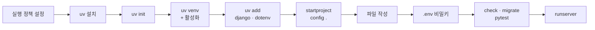
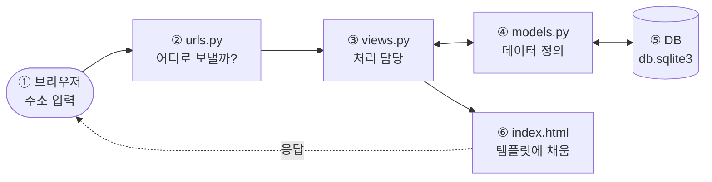
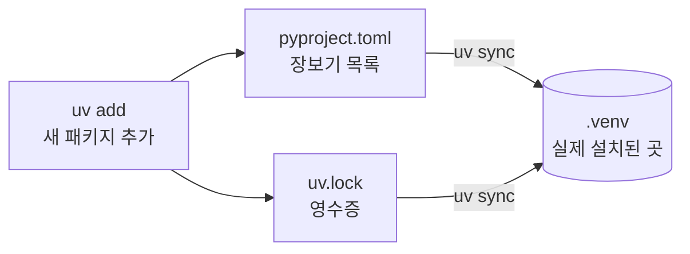
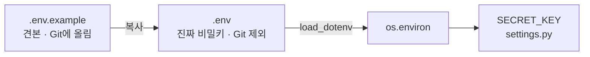
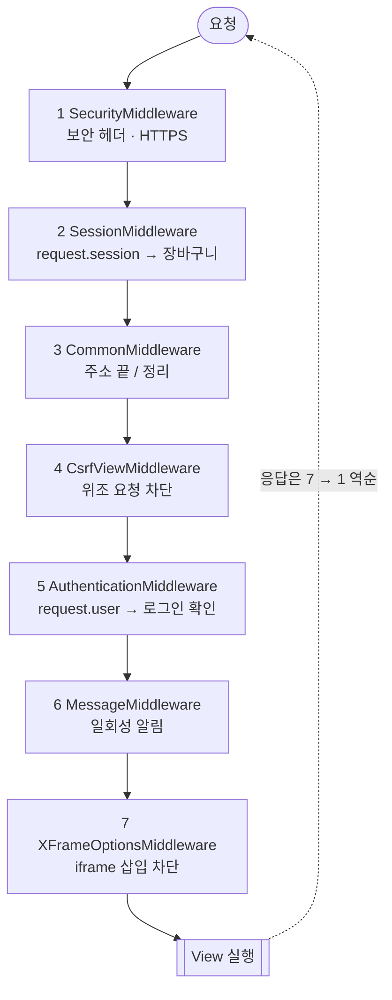

# 제1장 풀이노트 · Python 3.12 · uv · VS Code · Django 5.2.7

교재 「제1장. Python 3.12 · uv · VS Code · Django」(33쪽)를 제 말로 다시 정리한 노트입니다.
그림과 클릭해서 보는 파일 탐색기가 있는 버전은 [chapter01-풀이노트.html](chapter01-풀이노트.html)을 내려받아 브라우저로 열면 볼 수 있습니다.

## 목차
1. [큰 그림](#1-큰-그림)
2. [진행 순서](#2-진행-순서)
3. [장고는 이렇게 움직인다 (MTV)](#3-장고는-이렇게-움직인다-mtv)
4. [학습 경로 A와 B](#4-학습-경로-a와-b)
5. [명령어 풀이](#5-명령어-풀이)
6. [파일별 역할](#6-파일별-역할)
7. [settings.py 뜯어보기](#7-settingspy-뜯어보기)
8. [앱 만들기와 지우기](#8-앱-만들기와-지우기)
9. [.env 만들고 실행하기](#9-env-만들고-실행하기)
10. [오류 해결](#10-오류-해결)
11. [확인 문제](#11-확인-문제)

---

## 1. 큰 그림

1장에서 하는 일은 결국 **"장고 웹사이트가 돌아갈 방을 꾸미는 것"** 입니다. 아래에서 위로 쌓아 올립니다.

| 층 | 무엇 | 하는 일 |
|---|---|---|
| 6 | **내 프로젝트** (`manage.py`, `config/`) | 장고가 만들어 준 뼈대 위에 내 코드를 얹는다 |
| 5 | **Django 5.2.7** | 주소 처리, DB, 관리자 페이지 같은 웹 기능을 미리 만들어 둔 도구 상자 |
| 4 | **.venv** | 이 프로젝트 전용 방. 다른 프로젝트와 패키지가 섞이지 않게 분리 |
| 3 | **Python 3.12** | `.python-version`에 적힌 버전을 uv가 골라 쓴다 |
| 2 | **uv** | 파이썬 설치, 가상환경 생성, 패키지 설치를 혼자 다 한다 (pip + venv + pyenv 역할) |
| 1 | **PowerShell · VS Code** | 명령을 치는 곳, 코드를 고치는 곳 |

> **왜 uv인가?** 예전에는 파이썬 설치, 가상환경(`python -m venv`), 패키지 설치(`pip`)를 따로 했습니다. uv는 이걸 한 도구로 묶었고 속도도 훨씬 빠릅니다.

### 장고란?
파이썬으로 웹사이트를 만들 때 쓰는 **웹 프레임워크**입니다. 맨땅에 벽돌부터 쌓는 대신 골조·배관·전기·현관 잠금장치까지 갖춘 조립식 주택 키트를 받는 것과 같습니다.

| 늘 필요한 기능 | 직접 만들면 | 장고에서는 |
|---|---|---|
| 주소별 화면 | 주소마다 분기 처리 | `urls.py`에 한 줄 |
| 데이터 저장 | SQL 직접 작성 | `models.py`의 파이썬 클래스 |
| 회원·로그인·암호화 | 보안 지식이 많이 필요 | `django.contrib.auth` 기본 제공 |
| 관리자 페이지 | 처음부터 제작 | `/admin/` 자동 생성 |
| 해킹 방어 (CSRF 등) | 놓치기 쉬움 | 미들웨어가 기본으로 막음 |

---

## 2. 진행 순서



교재는 `C:\lab`을 쓰지만 저는 수업 폴더 `C:\sk-encore\app_workspace`에서 진행했습니다. 경로만 바꿔 읽으면 됩니다.

---

## 3. 장고는 이렇게 움직인다 (MTV)

장고는 **MTV 패턴**으로 일을 셋으로 나눕니다.

- **M**odel (`models.py`): 데이터 모양. "상품에는 이름, 가격, 재고가 있다" 같은 정의
- **T**emplate (`index.html`): 화면 모양. 데이터를 끼워 넣을 HTML 틀
- **V**iew (`views.py`): 처리 로직. 데이터를 가져와 틀에 채워서 돌려준다



> 1장에서는 일부만 씁니다. `config/urls.py` 안에 `home()` 함수를 만들어 HTML 글자를 바로 돌려줍니다. 템플릿·모델은 다음 장부터 붙습니다.

---

## 4. 학습 경로 A와 B

| | 경로 A · 빈 폴더에서 직접 작성 (제가 한 방식) | 경로 B · 완성 ZIP 바로 실행 |
|---|---|---|
| 1 | `uv init`으로 시작 | ZIP 압축 풀기 |
| 2 | `uv add`로 장고 설치 | `uv sync`로 패키지 한 번에 설치 |
| 3 | `startproject`로 뼈대 생성 | `.env` 만들기 |
| 4 | 교재 코드로 파일 내용 교체 | 바로 `check → migrate → runserver` |

> **섞으면 안 되는 이유:** ZIP에는 이미 `manage.py`와 `config/`가 있습니다. 그 위에서 `startproject`를 또 하면 "이미 있다"는 오류가 납니다.

---

## 5. 명령어 풀이

### 사전 준비 (필요한 사람만)
교재 2장(VS Code·uv 지우기)은 **예전 설치가 꼬였을 때만** 합니다. `Remove-Item -Recurse -Force`는 휴지통을 거치지 않고 지우므로 경로를 꼭 확인합니다.

### 실행 정책 (한 번만)
```powershell
Set-ExecutionPolicy RemoteSigned -Scope CurrentUser
Get-ExecutionPolicy -List   # CurrentUser 줄이 RemoteSigned면 성공
```
윈도우는 기본으로 `.ps1` 스크립트 실행을 막습니다. 가상환경을 켜는 `Activate.ps1`도 스크립트라서 이 설정을 풀어야 합니다. `RemoteSigned`는 "내 PC에서 만든 건 허용, 인터넷에서 받은 건 서명 필요"라는 뜻이고, **한 번 설정하면 계속 유지됩니다.**

### uv 설치
```powershell
irm https://astral.sh/uv/install.ps1 | iex
uv --version
```
`irm`이 설치 스크립트를 내려받고, `|`(파이프)가 그 결과를 넘기면, `iex`가 실행합니다.

### 프로젝트 만들기
```powershell
uv python install 3.12                   # uv가 관리하는 파이썬 3.12 설치
uv init chapter01_project --python 3.12  # 폴더 + pyproject.toml + .python-version + main.py
cd .\chapter01_project
```

### 가상환경
```powershell
uv venv                                          # .python-version(3.12)을 보고 .venv 생성
.venv\Scripts\activate                           # 프롬프트 앞에 (.venv)가 붙으면 성공
python -c "import sys; print(sys.executable)"    # ...\.venv\Scripts\python.exe 가 나와야 함
```
교재 본문은 `uv venv`, 결과 예시는 `uv venv .venv --python 3.12`로 적혀 있는데 **결과는 같습니다.**

### 패키지 설치
```powershell
uv add "django==5.2.7" "python-dotenv==1.1.1"
uv tree                  # 무엇이 무엇을 끌고 들어왔는지 나무 모양으로
uv lock --check          # uv.lock이 최신인지 확인
uv add --dev "pytest>=8,<10" "pytest-django>=4.8,<5"   # 개발 전용 패키지
```
`==`는 "정확히 이 버전", `>=8,<10`은 "8 이상 10 미만"입니다.



- `uv add`: 목록(pyproject.toml)과 영수증(uv.lock)을 고치고 설치까지 한다
- `uv sync`: 목록·영수증을 읽어 .venv를 그대로 맞춘다 → ZIP을 받은 경로 B는 `uv sync` 한 줄이면 된다

### 장고 뼈대 만들기
```powershell
uv run django-admin startproject config .
if (Test-Path .\main.py) { Remove-Item .\main.py }   # uv init이 만든 main.py는 장고에서 안 씀
```
끝의 **점(`.`)이 중요합니다.** "지금 폴더에 바로 만들어라"는 뜻이고, 빼면 `config\config\`처럼 한 겹 더 생깁니다.
`uv run`은 "이 프로젝트의 가상환경으로 실행해라"입니다. 가상환경을 켰든 안 켰든 항상 맞는 환경에서 돌아갑니다.

### 제가 실제로 낸 실수들
| 틀린 입력 | 원인 | 맞는 입력 |
|---|---|---|
| `cd . C:\sk-encore\...` | 점이 하나 더 있어 인수가 2개 | `cd C:\sk-encore\app_workspace\chapter01_project` |
| `uv venv .venv --python3.12` | 옵션과 값 사이 띄어쓰기 빠짐 | `uv venv .venv --python 3.12` |
| `..venv\Scripts\activate` | `..`은 "상위 폴더" | `.venv\Scripts\activate` |
| `PS> uv run python -c ...` | 교재의 `PS>`는 프롬프트 표시 | `uv run python -c ...` |

---

## 6. 파일별 역할

```
chapter01_project/
├── .venv/                  # [uv venv]      이 프로젝트 전용 파이썬 + 패키지 (Git 제외)
├── .python-version         # [uv init]      "3.12" 한 줄. uv가 보는 표지판
├── pyproject.toml          # [uv init/add]  프로젝트 이름·파이썬 조건·패키지 목록
├── uv.lock                 # [uv add/sync]  실제 설치된 정확한 버전 기록 (직접 수정 X)
├── .gitignore              # [직접 작성]    Git에 안 올릴 목록
├── .env.example            # [직접 작성]    환경변수 견본 (공개 OK)
├── .env                    # [복사]         진짜 비밀키 (절대 공유 X)
├── manage.py               # [startproject] 장고 명령의 입구 (check, migrate, runserver ...)
├── config/                 # [startproject] 프로젝트 설정 패키지
│   ├── __init__.py         #   빈 파일. config를 파이썬 패키지로 인식시킴
│   ├── settings.py         #   장고 설정의 본체
│   ├── urls.py             #   주소 → 처리 함수 연결표
│   ├── asgi.py             #   비동기 서버 입구 (배포용)
│   └── wsgi.py             #   동기 서버 입구 (배포용)
├── hello.py                # [직접 작성]    파이썬 동작 확인
├── check_environment.py    # [직접 작성]    3.12인지, 장고 깔렸는지 진단
├── tests/                  # [직접 작성]    pytest 테스트
│   ├── test_hello.py       #   hello.py 출력 검사
│   └── test_django.py      #   첫 화면 200 응답 검사
└── db.sqlite3              # [migrate 후]   SQLite DB 파일 (7장에서 MySQL로 교체)
```

`main.py`는 `uv init`이 만들어 주지만 장고는 `manage.py`로 실행하므로 지웁니다.

---

## 7. settings.py 뜯어보기

### BASE_DIR · 프로젝트 루트 찾기
```python
BASE_DIR = Path(__file__).resolve().parent.parent
```
"settings.py가 있는 곳에서 두 칸 위로 올라가면 프로젝트 맨 위 폴더"라는 계산입니다.

```
chapter01_project\          ← .parent.parent = BASE_DIR
├─ manage.py
├─ .env
└─ config\                  ← .parent
   ├─ settings.py           ← __file__ (나 자신)
   └─ urls.py
```

| 코드 | 결과 |
|---|---|
| `Path(__file__).resolve()` | `...\chapter01_project\config\settings.py` |
| `.parent` | `...\chapter01_project\config` |
| `.parent.parent` | `...\chapter01_project` |

`BASE_DIR / ".env"`의 `/`는 나눗셈이 아니라 **경로를 이어 붙이는 기호**입니다.

### 비밀키와 .env

```python
load_dotenv(BASE_DIR / ".env")
SECRET_KEY = os.environ["DJANGO_SECRET_KEY"]                    # 없으면 즉시 에러로 멈춤
DEBUG = os.getenv("DJANGO_DEBUG", "False").lower() == "true"   # 없으면 False
```
- **SECRET_KEY**: 로그인 세션, 비밀번호 재설정 링크 등을 서명하는 열쇠. 코드에 쓰면 GitHub에 올리는 순간 유출되므로 `.env`로 뺀다
- `os.environ[...]`은 값이 없으면 **바로 KeyError**를 낸다. 아무 키로 돌아가는 것보다 "비밀키 없음"을 확실히 알리는 게 안전하다는 설계
- **DEBUG**: 개발 중엔 True(에러 화면 자세히), 서비스에선 False

### 나머지 항목
| 항목 | 뜻 | 1장 값 |
|---|---|---|
| `ALLOWED_HOSTS` | 이 주소로 온 요청만 받는다 | 127.0.0.1, localhost, testserver |
| `ROOT_URLCONF` | 주소표 위치 | config.urls |
| `TEMPLATES` | HTML 틀을 찾는 곳 | 각 앱의 templates 폴더 |
| `DATABASES` | 사용할 DB | SQLite (7장에서 MySQL) |
| `AUTH_PASSWORD_VALIDATORS` | 비밀번호 규칙 4종 | 개인정보 유사·8자 미만·흔한 비번·숫자만 금지 |
| `LANGUAGE_CODE` · `TIME_ZONE` | 언어·시간대 | ko-kr · Asia/Seoul |
| `STATIC_URL` | CSS·JS·이미지 주소 앞부분 | static/ |
| `DEFAULT_AUTO_FIELD` | 자동 번호(id) 타입 | BigAutoField |

### INSTALLED_APPS · 쓸 기능 등록부
**패키지를 설치하는 곳이 아니라, 설치된 앱을 프로젝트에 등록하는 곳**입니다.

| 앱 | 하는 일 | 쇼핑몰이라면 |
|---|---|---|
| `admin` | 관리자 페이지 | 상품·주문 관리 |
| `auth` | 회원·로그인·권한 | 회원가입·로그인 |
| `contenttypes` | 모델 종류 식별 | 모델별 권한 |
| `sessions` | 사용자별 임시 저장 | 로그인 유지·장바구니 |
| `messages` | 한 번만 뜨는 알림 | "상품이 등록되었습니다" |
| `staticfiles` | CSS·JS·이미지 관리 | 상품 이미지 |

### MIDDLEWARE · 요청이 지나가는 검문소
요청은 **위 → 아래**로, 응답은 **아래 → 위**로 통과합니다. 그래서 순서가 중요합니다.



5번(로그인 사용자)은 2번(세션)이 먼저 있어야 동작합니다. CSRF 토큰 없는 POST 요청은 4번에서 막혀 View까지 가지 못하고 403으로 돌아갑니다.

| 구분 | INSTALLED_APPS | MIDDLEWARE |
|---|---|---|
| 목적 | 쓸 기능(앱) 등록 | 요청·응답 공통 처리 |
| 비유 | 건물에 입점한 가게 목록 | 건물 입구 보안 검색대 |
| 순서 | 일부만 중요 | 매우 중요 |

---

## 8. 앱 만들기와 지우기

"프로젝트"는 사이트 전체, "앱"은 그 안의 기능 묶음(게시판·회원·상품)입니다. `startapp`은 폴더만 만들고 **등록은 해 주지 않습니다.**

- **만들기**: `startapp boards` → INSTALLED_APPS 등록 → views·urls·models 작성 → `check` → `makemigrations` → `migrate`
- **지우기**: 백업·참조 확인 → `migrate boards zero` → urls·import 제거 → INSTALLED_APPS 제거 → 폴더 삭제 → `check`

```python
# config/settings.py
INSTALLED_APPS = [..., "boards", "accounts", "products"]
# config/urls.py
path("boards/", include("boards.urls")),
```

> 교재 등록 방법 ②의 `"boards.apps.BoardConfig"`는 오타이고, startapp이 만드는 실제 이름은 `BoardsConfig`입니다.

---

## 9. .env 만들고 실행하기

```powershell
Copy-Item .env.example .env
uv run python -c "from django.core.management.utils import get_random_secret_key; print(get_random_secret_key())"
# 출력된 키를 .env의 DJANGO_SECRET_KEY= 뒤에 붙여넣기

uv run python check_environment.py   # 3.12인지, 장고가 깔렸는지
uv run pytest -v                     # 테스트 통과 확인
uv run python manage.py check        # System check identified no issues
uv run python manage.py migrate      # db.sqlite3에 기본 테이블 생성
uv run python manage.py runserver 127.0.0.1:8000
```
- **check**: 설정 검사만 한다. 아무것도 바꾸지 않는다
- **migrate**: admin·auth·sessions가 쓰는 테이블을 DB에 만든다
- **127.0.0.1**은 "내 컴퓨터", **8000**은 문 번호(포트)

---

## 10. 오류 해결

| 증상 | 원인 | 해결 |
|---|---|---|
| uv 명령을 찾을 수 없음 | 설치 직후 PATH 미반영 | PowerShell 재시작 → `uv --version` |
| Activate.ps1 실행 불가 | 실행 정책이 막음 | `Get-ExecutionPolicy -List` 확인 후 RemoteSigned |
| No module named 'django' | 다른 폴더이거나 미설치 | 프로젝트 루트에서 `uv add` 또는 `uv sync` |
| KeyError: 'DJANGO_SECRET_KEY' | .env 없음 / 키 이름 다름 / **BOM** | 루트의 `.env` 확인 (아래 참고) |
| startproject: already exists | 경로 A·B를 섞음 | ZIP에는 manage.py가 있으니 생략 |
| port 8000 is already in use | 서버가 이미 켜져 있음 | 기존 서버 종료 또는 `:8001` |
| UnicodeDecodeError: 'cp949' | 한글 Windows 기본 인코딩 | 아래 참고 |

### 교재대로 했는데 막힌 2가지
1. **`.env`의 BOM**: `Set-Content .env -Encoding utf8`은 Windows PowerShell 5.1에서 파일 앞에 보이지 않는 BOM(EF BB BF)을 붙입니다. python-dotenv가 키 이름을 `\ufeffDJANGO_SECRET_KEY`로 읽어서 KeyError가 납니다. BOM 없이 저장하면 해결됩니다.
   ```powershell
   [IO.File]::WriteAllLines("$PWD\.env", $lines)
   ```
2. **`test_hello.py`의 cp949 오류**: hello.py는 한글을 UTF-8로 출력하는데, 테스트 쪽 `subprocess.run(text=True)`이 한글 Windows 기본값 cp949로 읽다가 깨집니다. `encoding="utf-8"`과 `PYTHONIOENCODING=utf-8`을 지정해서 해결했습니다.

---

## 11. 확인 문제

<details><summary><code>uv add</code>와 <code>uv sync</code>의 차이는?</summary>

`uv add`는 새 패키지를 목록에 **추가**하고 설치합니다. `uv sync`는 이미 적힌 목록·잠금 파일에 맞춰 .venv를 **맞춥니다**.
</details>

<details><summary><code>uv.lock</code>은 왜 있나?</summary>

하위 패키지(asgiref, sqlparse 등)까지 정확한 버전을 기록해서 다른 PC에서도 똑같은 환경을 재현합니다.
</details>

<details><summary><code>.env</code>와 <code>.env.example</code>의 차이는?</summary>

`.env`는 진짜 비밀값이라 Git에서 제외하고, `.env.example`은 필요한 이름만 적은 견본이라 공유합니다.
</details>

<details><summary><code>Set-Location</code>과 <code>cd</code>의 관계는?</summary>

같은 명령입니다. `cd`는 `Set-Location`의 별칭이고, `ls`·`dir`도 `Get-ChildItem`의 별칭입니다.
</details>

<details><summary>SECRET_KEY를 코드에 직접 쓰지 않는 이유는?</summary>

코드는 공유되므로 유출 위험이 있고, 개발·운영 환경마다 다른 키를 쓰기 위해 설정을 코드에서 분리합니다.
</details>

<details><summary><code>startproject config .</code>에서 마지막 점을 빼면?</summary>

`config\` 안에 다시 `manage.py`와 `config\`가 생겨 한 겹 깊어지고, 교재 경로·명령이 전부 어긋납니다.
</details>
