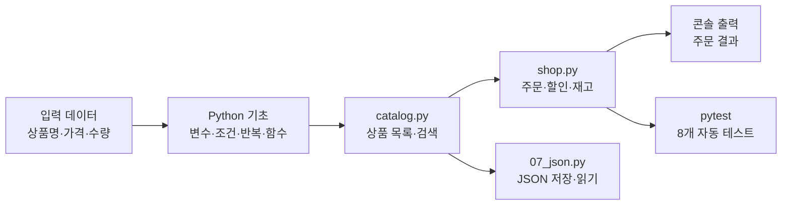
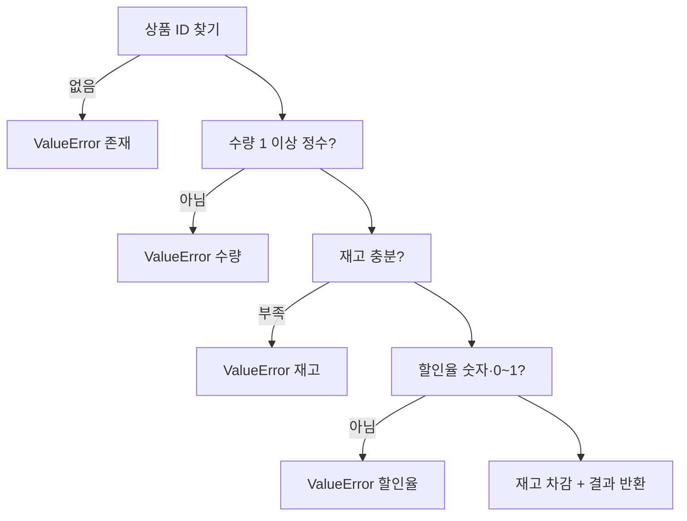

# 제2장 풀이노트 · Python 기본 문법과 상품 데이터 처리

1장에서 만든 uv + Python 3.12 환경 위에서, 변수부터 함수·JSON·예외까지 파이썬 기본기를 **상품 데이터** 하나로 연습하는 장입니다. Django는 아직 쓰지 않습니다.

## 1. 큰 그림



01~08번 파일로 문법을 하나씩 익힌 뒤, `catalog.py`(상품 목록)와 `shop.py`(주문 처리)로 합쳐서 작은 콘솔 쇼핑몰을 만듭니다.

## 2. 파일별로 배우는 것

| 파일 | 배우는 문법 | 실행 결과 |
|---|---|---|
| `01_variables.py` | 문자열·정수·불리언, `type()` | `상품명: 무선 키보드 str` … |
| `02_calculate.py` | 산술 연산, `//`, f-string `:,` | `결제 금액: 63,000원` |
| `03_condition.py` | `if / elif / else` | `주문 가능` |
| `04_loop.py` | 리스트 안의 딕셔너리, `for` | `키보드` |
| `05_functions.py` | 함수, 기본값 매개변수, `raise` | `63000` |
| `catalog.py` | 리스트 컴프리헨션, `casefold()` | `['무선 키보드', '무선 마우스']` |
| `07_json.py` | `json.dumps/loads`, `pathlib` | `저장 건수: 1` |
| `08_exceptions.py` | `try / except` | `수량: 3`, `오류: …` |
| `shop.py` | 위 전부 + `Decimal` | `주문: 무선 키보드 2개 / 63,000원` |

## 3. 핵심 코드 풀이

### 돈 계산은 정수로
```python
discount = subtotal * discount_percent // 100
print(f"결제 금액: {subtotal - discount:,}원")
```
- `0.1 + 0.2`가 `0.30000000000000004`가 되는 것처럼 **실수는 오차가 생깁니다.** 그래서 원화는 정수로 계산합니다.
- `//`는 몫만 남기는 나눗셈이라 원 미만을 버립니다.
- `{값:,}`는 천 단위 쉼표를 붙입니다.

### 조건문은 "잘못된 경우"부터
```python
if quantity <= 0:      print("수량 오류")
elif quantity > stock: print("재고 부족")
else:                  print("주문 가능")
```
위에서부터 차례로 검사하므로 가장 기본적인 오류(수량 0 이하)를 먼저 걸러냅니다.

### 검색: 리스트 컴프리헨션 + casefold
```python
term = keyword.strip().casefold()
return [item for item in PRODUCTS if term in item["name"].casefold()]
```
- `strip()`: 앞뒤 공백 제거 → `"  마우스  "`도 검색됩니다.
- `casefold()`: 대소문자 무시 (`lower()`보다 더 강한 버전)
- `[A for x in 목록 if 조건]`: "조건에 맞는 것만 골라 새 리스트"를 한 줄로 씁니다.

### 주문 함수의 순서가 중요한 이유

**모든 검사를 통과한 다음에만** `product["stock"] -= quantity`를 실행합니다. 할인율이 `"abc"`처럼 잘못됐는데 재고부터 깎으면 주문은 실패했는데 재고만 줄어드는 버그가 생깁니다. `test_invalid_discount_text_preserves_stock` 테스트가 바로 이걸 확인합니다.

### Decimal로 할인율 계산
```python
rate = Decimal(discount_rate)          # "0.10" 같은 문자열을 정확한 소수로
discount = int(Decimal(subtotal) * rate)
```
할인율을 `"0.10"` 문자열로 받아 `Decimal`로 바꾸면 실수 오차 없이 계산됩니다.

### pytest fixture로 재고 원상복구
```python
@pytest.fixture(autouse=True)
def restore_products():
    snapshot = deepcopy(PRODUCTS)   # 테스트 전에 복사
    yield                           # 여기서 테스트 실행
    PRODUCTS[:] = snapshot          # 테스트 후 복구
```
주문 테스트가 재고를 깎으면 다음 테스트 결과가 달라집니다. `autouse=True`라서 모든 테스트 앞뒤에 자동으로 붙고, 테스트끼리 서로 영향을 주지 않습니다.

## 4. 테스트 8개가 확인하는 것

| 테스트 | 확인 내용 |
|---|---|
| `test_search` | "키보드" 검색 → id 1 |
| `test_order_and_stock` | 35,000 × 2 × 90% = 63,000, 재고 5→3 |
| `test_invalid_quantity` | 0개 주문 → "수량" 오류 |
| `test_out_of_stock` | 품절 모니터 주문 → "재고" 오류 |
| `test_unknown_product` | 없는 id 99 → "존재" 오류 |
| `test_invalid_discount_rate` | 할인율 1.2 → "할인율" 오류 |
| `test_invalid_discount_text_preserves_stock` | 할인율 "abc" → 오류 + 재고 그대로 5 |
| `test_available_products` | 재고 있는 상품 2개 |

## 5. 교재와 다르게 한 곳

| 내용 | 이유 |
|---|---|
| zip의 `09_shop.py` → `shop.py` | 테스트가 `from shop import order`로 불러오므로 교재 이름대로 맞춤 |
| `pyproject.toml`에 `pythonpath = ["."]` 추가 | 없으면 `tests/conftest.py`에서 `ModuleNotFoundError: No module named 'catalog'` (직접 확인) |
| `DJANGO_SETTINGS_MODULE` 줄 제거 | 2장은 Django가 없어 pytest가 "모르는 설정" 경고만 냄 |

## 6. 확인 문제

<details><summary>list와 dict의 차이는?</summary>

list는 순서가 있는 항목 모음(`[0]`, `[1]`로 접근), dict는 키와 값의 쌍(`["name"]`으로 접근)입니다.
</details>

<details><summary>할인 계산에서 <code>//</code>를 쓰는 이유는?</summary>

원 미만 금액을 버리고 정수 금액을 얻기 위해서입니다.
</details>

<details><summary>함수의 return은 무엇을 하나?</summary>

함수의 실행 결과를 호출한 위치로 돌려줍니다.
</details>

<details><summary>JSON 저장 시 <code>ensure_ascii=False</code>의 의미는?</summary>

한글을 `무…` 같은 이스케이프 대신 그대로 기록합니다.
</details>

<details><summary>pytest fixture가 필요한 이유는?</summary>

테스트끼리 공유하는 재고 데이터를 매번 복원해서 실행 순서에 영향을 받지 않게 하려고 씁니다.
</details>

<details><summary>주문 전에 수량과 할인율을 먼저 검사하는 이유는?</summary>

잘못된 주문인데 재고만 줄어드는 부작용을 막기 위해서입니다.
</details>
