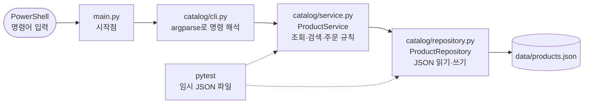

# 제3장 풀이노트 · Python 모듈·예외 처리·JSON 상품 관리

2장에서 파일 하나에 몰려 있던 상품 처리 코드를 **역할별 모듈로 나누고**, 메모리에만 있던 재고를 **JSON 파일에 저장**하고, **명령줄(CLI) 프로그램**으로 만드는 장입니다.

## 1. 2장과 무엇이 달라졌나

| 구분 | 2장 | 3장 |
|---|---|---|
| 프로그램 구조 | 단일 파일 중심 | `catalog` 패키지로 역할 분리 |
| 상품 데이터 | 리스트·딕셔너리 (끄면 사라짐) | JSON 파일 읽기·쓰기 (남아 있음) |
| 주문 처리 | 함수 호출과 재고 차감 | service와 repository 계층 분리 |
| 오류 처리 | `ValueError` 하나 | 사용자 정의 예외 3종 |
| 테스트 | pytest 기본 | fixture + `tmp_path`로 모듈별 테스트 |

## 2. 계층 구조



식당에 비유하면 이렇습니다.
- **cli.py** = 홀 직원: 손님 말을 알아듣고 결과를 전해 줌
- **service.py** = 주방장: "재고 없으면 주문 불가" 같은 규칙을 판단
- **repository.py** = 창고 관리인: 재료(데이터)를 꺼내고 넣는 일만 함

이렇게 나누면 나중에 JSON을 MySQL로 바꿀 때 **repository.py만 고치면 됩니다.** 7장에서 실제로 그렇게 합니다.

## 3. 파일별 역할

```
chapter03_project/
├── main.py                  # 시작점. catalog.cli.main()만 호출
├── catalog/                 # 상품 관리 패키지
│   ├── __init__.py          #   "이 폴더는 패키지"라는 표시
│   ├── exceptions.py        #   사용자 정의 예외
│   ├── repository.py        #   JSON 저장·조회
│   ├── service.py           #   검색·주문·재고 규칙
│   └── cli.py               #   list / search / order 명령
├── data/products.json       # order 실행 시 생성 (Git 제외)
├── tests/
│   ├── conftest.py          #   공통 fixture (임시 저장소)
│   ├── test_repository.py   #   4개
│   ├── test_service.py      #   6개
│   └── test_cli.py          #   3개
└── exercises/solutions.py   # 과제 풀이
```

## 4. 핵심 코드 풀이

### 사용자 정의 예외: 오류에 이름 붙이기
```python
class ProductError(Exception): ...                   # 부모
class ProductNotFoundError(ProductError): ...        # 상품 없음
class InsufficientStockError(ProductError): ...      # 재고 부족
```
`ValueError` 하나로 다 처리하면 "상품이 없는 건지, 재고가 없는 건지"를 메시지 글자로만 구분해야 합니다. 이름을 붙이면 `except ProductNotFoundError:`처럼 **종류별로 다르게 처리**할 수 있습니다. 부모 `ProductError`를 잡으면 둘 다 한 번에 잡힙니다.

### repository: 파일이 없으면 기본값
```python
def load(self):
    if not self.path.exists():
        return [product.copy() for product in DEFAULT_PRODUCTS]   # 첫 실행
    with self.path.open("r", encoding="utf-8") as file:
        data = json.load(file)
    if not isinstance(data, list):
        raise ValueError("상품 데이터는 리스트여야 합니다.")
    return data
```
- 처음 실행하면 파일이 없으니 기본 상품 3개를 돌려줍니다.
- `.copy()`로 복사해서 돌려주는 이유: 원본 `DEFAULT_PRODUCTS`가 주문으로 바뀌지 않게 하려고
- `save()`는 `mkdir(parents=True, exist_ok=True)`로 `data/` 폴더가 없으면 만들고 저장합니다.

### service: 의존성 주입
```python
class ProductService:
    def __init__(self, repository: ProductRepository):
        self.repository = repository
```
service가 저장소를 **직접 만들지 않고 밖에서 받습니다.** 그래서 테스트에서는 임시 경로의 저장소를, 실제 실행에서는 `data/products.json` 저장소를 끼워 넣을 수 있습니다.

### cli: argparse로 명령 만들기
```powershell
uv run python main.py list
uv run python main.py search 키보드
uv run python main.py order 1 2
```
`add_subparsers`로 `list / search / order` 세 명령을 만들고, `order`는 `product_id`, `quantity`를 정수로 받습니다. 오류가 나면 `오류: …`를 출력하고 **종료 코드 1**을 돌려줍니다(성공은 0). 다른 프로그램이 성공·실패를 판단할 때 이 숫자를 봅니다.

### 테스트: tmp_path로 진짜 파일을 안 건드림
```python
@pytest.fixture
def service(tmp_path):
    repository = ProductRepository(tmp_path / "products.json")
    return ProductService(repository)
```
`tmp_path`는 pytest가 테스트마다 새로 만들어 주는 임시 폴더입니다. 테스트에서 주문을 해도 실제 `data/products.json`은 바뀌지 않습니다.

## 5. 실행 결과 (직접 확인)

```
> uv run python main.py list
1. 무선 키보드 | 31,500원 | 재고 5
2. 무선 마우스 | 19,000원 | 재고 8
3. 모니터 | 190,000원 | 재고 0

> uv run python main.py order 1 2
주문 완료: 무선 키보드 2개 / 63,000원
남은 재고: 3

> uv run python main.py order 999 1
오류: 상품 999번이 없습니다.          (종료 코드 1)

> uv run pytest
13 passed
```
`order` 후 다시 `list`를 하면 재고가 3으로 남아 있습니다. 2장과 달리 **파일에 저장됐기 때문**입니다. 처음 상태로 돌리려면 `data/products.json`을 지우면 됩니다.

## 6. 교재와 다르게 한 곳

| 내용 | 이유 |
|---|---|
| `exercises/solutions.py` 위에 `sys.path.insert(...)` 추가 | 교재 명령 `uv run python exercises/solutions.py`를 그대로 실행하면 `ModuleNotFoundError: No module named 'catalog'`. 파이썬은 실행한 파일이 있는 `exercises/`만 경로에 넣기 때문. 2장 `answers.py`와 같은 방식으로 해결 |

## 7. 확인 문제

<details><summary>모듈과 패키지의 차이는?</summary>

모듈은 `.py` 파일 하나, 패키지는 관련 모듈을 묶은 폴더(`__init__.py` 포함)입니다.
</details>

<details><summary><code>if __name__ == "__main__":</code>의 목적은?</summary>

직접 실행할 때만 아래 코드를 돌리고, 다른 파일에서 import할 때는 실행되지 않게 합니다.
</details>

<details><summary>사용자 정의 예외가 필요한 이유는?</summary>

상품 없음·재고 부족 같은 업무 실패를 종류별로 구분해서 처리하기 위해서입니다.
</details>

<details><summary>pytest의 <code>tmp_path</code>를 쓰는 이유는?</summary>

테스트마다 임시 파일을 써서 실제 `data/products.json`을 바꾸지 않기 위해서입니다.
</details>

<details><summary>conftest.py는 어떻게 실행하나?</summary>

직접 실행하지 않습니다. `uv run pytest`를 하면 pytest가 자동으로 불러옵니다.
</details>
