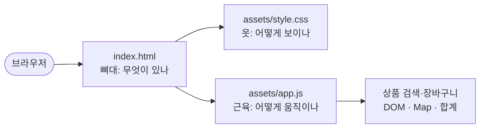
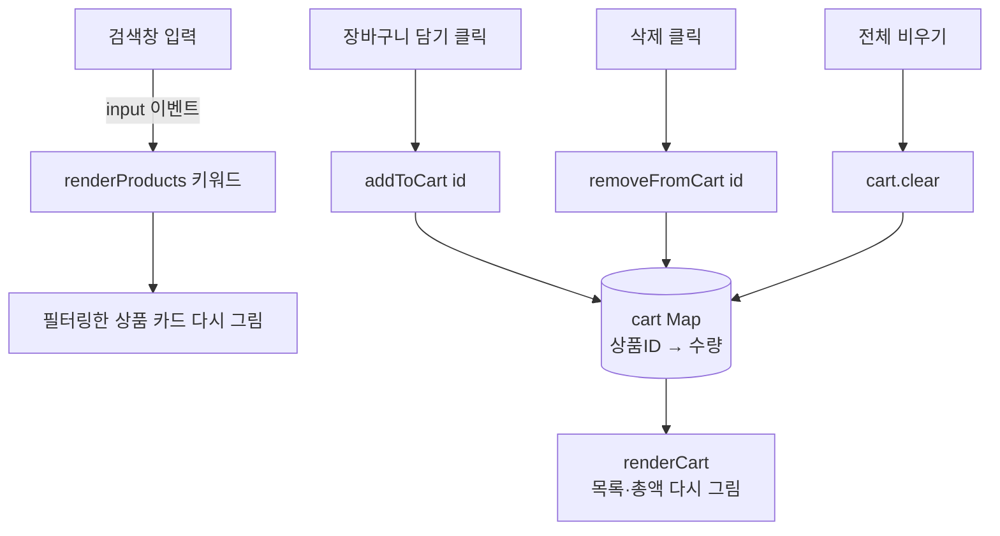

# 제4장 풀이노트 · HTML·CSS·JavaScript 상품 웹 화면

지금까지는 콘솔에 글자로만 출력했다면, 이번 장은 **브라우저 화면**을 만듭니다. 파이썬 서버 없이 HTML·CSS·JavaScript 세 파일로 상품 카탈로그와 장바구니를 만듭니다.

## 1. 세 파일의 역할



| 파일 | 비유 | 하는 일 |
|---|---|---|
| `index.html` | 뼈대 | 제목, 검색창, 상품 목록 자리, 장바구니 자리 |
| `style.css` | 옷 | 색, 카드 모양, 3열 → 2열 → 1열 반응형 |
| `app.js` | 근육 | 검색하면 카드 다시 그리기, 담기·삭제·합계 |

## 2. HTML: id가 JavaScript와의 연결 고리

```html
<input id="search" type="search" ...>
<section id="product-list" class="product-grid" aria-live="polite"></section>
<ul id="cart-items" aria-live="polite"></ul>
<p id="cart-total">총액: 0원</p>
<button id="clear-cart">전체 비우기</button>
<script src="assets/app.js" defer></script>
```
- 상품 목록 `<section>`은 **처음엔 비어 있습니다.** JavaScript가 채웁니다.
- `id`는 JavaScript가 `document.querySelector("#search")`로 찾아오는 이름표입니다.
- `defer`: HTML을 다 읽은 다음 스크립트를 실행합니다. 없으면 아직 만들어지지 않은 `#search`를 찾다가 `null` 오류가 납니다.
- `aria-live="polite"`: 내용이 바뀌면 화면 낭독기가 읽어 줍니다(접근성).

## 3. CSS: 반응형 그리드

```css
.product-grid { display: grid; grid-template-columns: repeat(3, minmax(0, 1fr)); gap: 18px; }
@media (max-width: 760px) { .product-grid { grid-template-columns: repeat(2, minmax(0, 1fr)); } }
@media (max-width: 520px) { .product-grid { grid-template-columns: 1fr; } }
```
| 화면 폭 | 열 수 |
|---|---|
| 760px 초과 (PC) | 3열 |
| 520~760px (태블릿) | 2열 |
| 520px 이하 (휴대폰) | 1열 |

`1fr`은 "남은 공간을 1만큼"이라는 뜻이라 `repeat(3, 1fr)`은 똑같은 폭 3칸입니다.

## 4. JavaScript: 상태 → 화면



핵심은 **"데이터(cart)를 바꾸고 → 화면을 통째로 다시 그린다"** 는 흐름입니다. 화면을 조금씩 고치는 대신 매번 새로 그리면 데이터와 화면이 어긋날 일이 없습니다. React 같은 도구도 같은 원리입니다.

### Map으로 장바구니
```javascript
const cart = new Map();                                  // 상품ID → 수량
cart.set(productId, (cart.get(productId) || 0) + 1);     // 담기
cart.delete(productId);                                  // 삭제
```
`|| 0`은 "아직 없으면 0으로 치고"라는 뜻입니다. 같은 상품을 두 번 담으면 수량이 2가 됩니다.

### textContent vs innerHTML (보안)
```javascript
title.textContent = product.name;     // ✅ 글자로만 넣음
// el.innerHTML = product.name;       // ❌ HTML로 해석함
```
상품명에 `<script>…</script>`가 들어 있으면 `innerHTML`은 그걸 실행해 버립니다(XSS 공격). `textContent`는 그냥 글자로 보여 줍니다. 테스트 `test_no_unsafe_inner_html`이 app.js에 `innerHTML`이 없는지 검사합니다.

### toLocaleString으로 원화 표시
```javascript
const formatPrice = (price) => `${price.toLocaleString("ko-KR")}원`;   // 79000 → "79,000원"
```

## 5. 실행과 확인

```powershell
uv run pytest -v                       # 파일 구성 검사 6개
uv run python -m http.server 8000      # http://localhost:8000
```
pytest는 **파일 구조만** 검사합니다(파일 존재, HTML이 CSS·JS를 연결하는지, 함수 이름, `@media` 유무, `innerHTML` 미사용). 실제 클릭 동작은 브라우저에서 확인해야 합니다.

### 브라우저에서 직접 확인한 결과
| 동작 | 결과 |
|---|---|
| 처음 열기 | 상품 카드 6개 |
| "키보드" 검색 | 기계식 키보드 1개만 남음 |
| 기계식 키보드 2번 + 웹캠 1번 담기 | `기계식 키보드 × 2 — 158,000원`, `웹캠 × 1 — 49,000원`, 총액 207,000원 |
| 첫 항목 삭제 | 총액 49,000원 |
| 전체 비우기 | "장바구니가 비어 있습니다.", 총액 0원 |
| 폭 375px(휴대폰) | 카드 1열 |

새로고침하면 장바구니는 비워집니다. 저장 기능(localStorage)은 아직 만들지 않았기 때문입니다.

## 6. 교재와 다르게 한 곳

| 내용 | 이유 |
|---|---|
| `uv add --dev "pytest>=8,<10"` 실행 | 교재 단계 03에 있는 명령인데 zip의 `pyproject.toml`에는 반영되어 있지 않아서 실행 |

## 7. 실습 과제 요약

| 과제 | 풀이 |
|---|---|
| 상품 1개 추가 | `PRODUCTS`에 `{ id: 7, name: "모니터 받침대", price: 32000, … }` 추가 |
| 가격순 정렬 | `filtered.sort((a, b) => a.price - b.price);` |
| 수량 1개 감소 | `decreaseQuantity()` — 1개면 삭제, 아니면 -1 |
| 접근성 | `<label for="search">`는 입력란 이름을 알려 주고, `aria-live`는 바뀐 내용을 낭독기에 알림 |

## 8. 확인 문제

<details><summary>HTML, CSS, JavaScript의 역할은?</summary>

HTML은 구조, CSS는 디자인, JavaScript는 동작과 상태를 맡습니다.
</details>

<details><summary><code>defer</code>의 역할은?</summary>

HTML 해석을 막지 않고 스크립트를 내려받아 두었다가, 문서를 다 읽은 뒤 실행합니다.
</details>

<details><summary>Map을 쓰는 이유는?</summary>

상품 ID를 키로 수량을 저장하고 고치기 쉽기 때문입니다.
</details>

<details><summary>textContent를 쓰는 이유는?</summary>

문자열을 HTML로 해석하지 않고 글자로만 출력해서 XSS를 막습니다.
</details>

<details><summary>pytest만으로 브라우저 기능을 검증할 수 있나?</summary>

아닙니다. 이 장의 pytest는 정적 구성만 확인하고, 클릭 동작은 브라우저에서 따로 확인해야 합니다.
</details>
