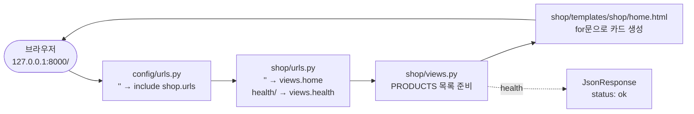
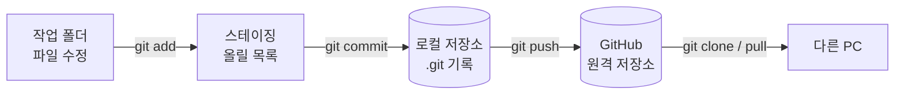

# 제5장 풀이노트 · Git·GitHub와 Django 쇼핑몰 프로젝트 구축

4장의 정적 HTML을 **Django 템플릿**으로 옮겨서, 서버가 상품 데이터를 HTML에 채워 보내는 구조를 만듭니다. 그리고 코드를 **Git으로 기록하고 GitHub에 올리는 법**을 배웁니다.

## 1. 4장과 무엇이 달라졌나

| | 4장 (정적 웹) | 5장 (Django) |
|---|---|---|
| 상품 데이터 위치 | 브라우저의 `app.js` | 서버의 `shop/views.py` |
| HTML 만드는 곳 | 브라우저 (JavaScript DOM) | 서버 (템플릿 렌더링) |
| 실행 | `python -m http.server` | `manage.py runserver` |
| 화면 소스 보기 | 상품 목록이 비어 있음 | 상품 이름이 HTML에 이미 들어 있음 |

## 2. 요청이 지나가는 길



1장은 `config/urls.py` 안에 함수를 바로 만들었지만, 5장부터는 **앱(shop)을 따로 만들고** 프로젝트 주소표가 앱 주소표를 `include`로 불러옵니다. 회원·게시판 같은 앱이 늘어나도 각자 자기 주소표만 관리하면 됩니다.

## 3. 프로젝트(config)와 앱(shop)

```
chapter05_project/
├── config/                  # 프로젝트 = 사이트 전체 설정
│   ├── settings.py          #   INSTALLED_APPS에 "shop" 등록
│   └── urls.py              #   path("", include("shop.urls"))
├── shop/                    # 앱 = 쇼핑몰 기능 묶음
│   ├── apps.py              #   ShopConfig
│   ├── urls.py              #   app_name = "shop", home / health
│   ├── views.py             #   PRODUCTS, home(), health()
│   ├── templates/shop/home.html
│   ├── static/shop/style.css
│   └── tests.py             #   Django TestCase 3개
├── tests/test_project_files.py   # pytest 5개
└── scripts/verify.ps1       # 검증 명령 모음
```

### 왜 templates/**shop**/home.html처럼 앱 이름 폴더를 한 번 더 두나?
Django는 모든 앱의 `templates/` 폴더를 한데 모아서 찾습니다. 다른 앱에도 `home.html`이 있으면 이름이 겹칩니다. 그래서 `shop/home.html`처럼 앱 이름으로 한 번 더 구분합니다. `static/shop/style.css`도 같은 이유입니다.

## 4. 핵심 코드 풀이

### view: 데이터를 템플릿에 넘기기
```python
def home(request):
    return render(request, "shop/home.html", {"products": PRODUCTS})

def health(request):
    return JsonResponse({"status": "ok", "service": "ai-shop"})
```
- `render(요청, 템플릿, 데이터)`: 템플릿에 데이터를 채워 HTML을 만듭니다.
- `health`: 서버가 살아 있는지 확인하는 주소입니다. 배포 환경에서 감시 도구가 이 주소를 주기적으로 찔러 봅니다.

### 템플릿 문법
```django

<link rel="stylesheet" href="">
<a href="">AI Shop</a>


  <h3>{{ product.name }}</h3>
  <p>재고 {{ product.stock }}개품절</p>

  <p>등록된 상품이 없다.</p>

```
| 문법 | 뜻 |
|---|---|
| `{{ 값 }}` | 값 출력 (자동으로 HTML 이스케이프 → 4장의 textContent와 같은 효과) |
| ` …  … ` | 반복, 목록이 비면 empty 부분 |
| ` …  … ` | 조건 |
| `` | 정적 파일 주소 만들기 |
| `` | 이름으로 주소 만들기 (`app_name:name`) |

### URL 이름을 쓰는 이유
```python
app_name = "shop"
path("", views.home, name="home")
```
템플릿과 테스트에서 `/`를 직접 쓰지 않고 `reverse("shop:home")`처럼 **이름**으로 부릅니다. 나중에 주소를 `/shop/`으로 바꿔도 이름을 쓰는 곳은 고칠 필요가 없습니다.

### settings.py: 1장과 다른 점
```python
SECRET_KEY = os.getenv("DJANGO_SECRET_KEY", "insecure-development-only-change-me")
```
1장은 `os.environ[...]`이라 `.env`가 없으면 바로 멈췄지만, 5장은 `getenv`에 **기본값**이 있어서 `.env` 없이도 실행됩니다. 연습용으로는 편하지만 운영에서는 반드시 진짜 키를 넣어야 합니다.

## 5. 테스트 두 종류

| | `shop/tests.py` | `tests/test_project_files.py` |
|---|---|---|
| 방식 | Django `TestCase` 클래스 | pytest 함수 + pytest-django |
| 실행 | `manage.py test shop` | `uv run pytest` |
| 개수 | 3개 | 5개 |
| 클라이언트 | `self.client` | `client` fixture |

`test_project_syntax`는 프로젝트의 모든 `.py`를 `ast.parse`로 읽어서 문법 오류가 없는지 검사합니다.

## 6. Git과 GitHub



| 명령 | 하는 일 |
|---|---|
| `git init` | 이 폴더를 Git 저장소로 만듦 (`.git` 생성) |
| `git status` | 바뀐 파일 확인 |
| `git add .` | 바뀐 파일을 커밋할 목록에 올림 |
| `git commit -m "..."` | 지금 상태를 기록(사진 찍기) |
| `git branch -M main` | 기본 브랜치 이름을 main으로 |
| `git remote add origin <주소>` | GitHub 저장소 주소 등록 |
| `git push -u origin main` | GitHub로 올림 |

- **Git**: 내 PC에서 변경 이력을 관리하는 도구
- **GitHub**: Git 저장소를 인터넷에 올려 두고 협업하는 서비스
- `.gitignore`의 `.env`, `.venv/`, `db.sqlite3`는 올라가지 않습니다.

> 저는 장마다 저장소를 따로 만들지 않고, 이 [APPWORK](../README.md) 저장소 하나에 장별 폴더로 올리고 있습니다.

## 7. 실행 결과 (직접 확인)

| 검사 | 결과 |
|---|---|
| `manage.py check` | System check identified no issues |
| `manage.py migrate` | 기본 테이블 생성 OK |
| `uv run pytest -v` | 5 passed |
| `manage.py test shop -v 2` | Ran 3 tests, OK |
| `http://127.0.0.1:8000/` | 카드 3개, 모니터는 "품절", CSS 적용 |
| `http://127.0.0.1:8000/health/` | `{"status": "ok", "service": "ai-shop"}` |

## 8. 교재와 다르게 한 곳

| 내용 | 이유 |
|---|---|
| `scripts/verify.ps1` 마지막 줄을 `uv run pytest -v`로 변경 | 교재의 `python -m unittest discover -s tests -v`는 pytest 함수형 테스트를 못 찾아서 `Ran 0 tests … NO TESTS RAN`으로 끝남 (직접 확인) |
| zip 없이 교재 코드로 직접 작성 | 5장은 완성 zip이 제공되지 않아 교재 단계 01~20을 그대로 옮김 |

## 9. 오류 해결

| 증상 | 해결 |
|---|---|
| `ModuleNotFoundError: django` | 프로젝트 루트에서 `uv add "django==5.2.7"` 후 `uv run`으로 실행 |
| `ImproperlyConfigured: Requested setting` | `pyproject.toml`의 `DJANGO_SETTINGS_MODULE`과 pytest-django 설치 확인 |
| `DisallowedHost` | `ALLOWED_HOSTS`에 127.0.0.1, localhost, testserver 확인 |
| `TemplateDoesNotExist` | `shop/templates/shop/home.html` 경로와 `APP_DIRS=True` 확인 |

## 10. 확인 문제

<details><summary>Git과 GitHub의 차이는?</summary>

Git은 로컬 변경 이력 관리 도구이고, GitHub는 원격 저장소·협업 서비스입니다.
</details>

<details><summary>Django의 URL → View → Template 순서는?</summary>

URL이 요청을 View에 연결하고, View가 데이터를 Template에 넘겨 HTML을 만들어 돌려줍니다.
</details>

<details><summary><code>uv init</code>과 <code>uv venv</code>의 차이는?</summary>

`uv init`은 프로젝트 기본 설정(pyproject.toml 등)을 만들고, `uv venv`는 가상환경(.venv)을 만듭니다.
</details>

<details><summary>pytest-django가 필요한 이유는?</summary>

Django 설정 로딩과 `client` 같은 Django 통합 테스트 기능을 pytest에서 쓸 수 있게 해 줍니다.
</details>
