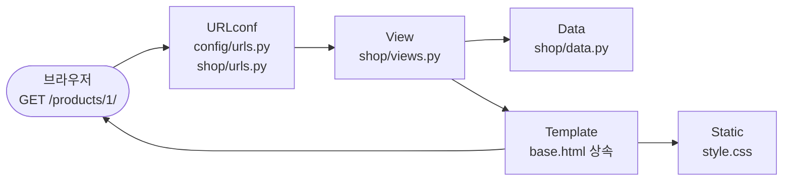
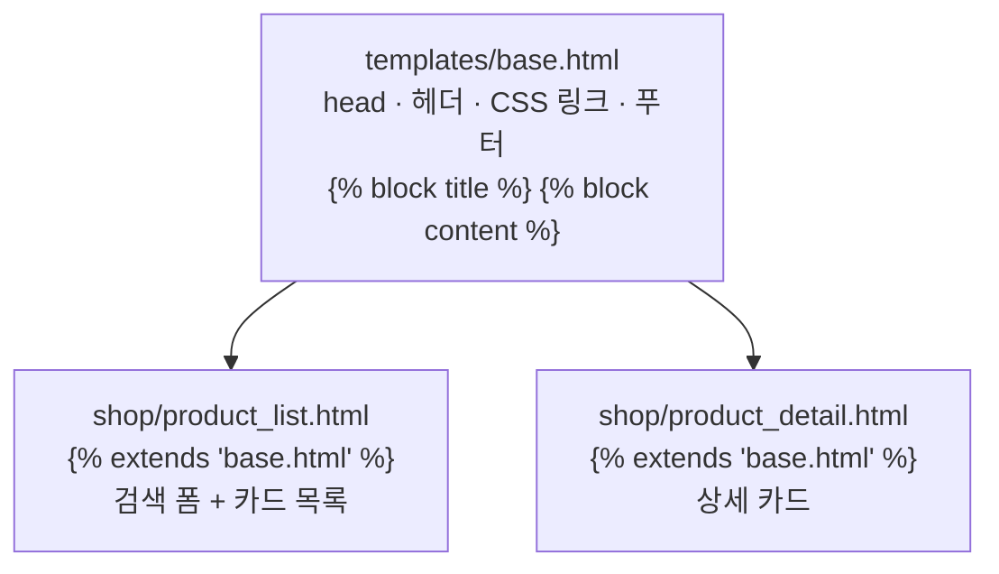

# 제6장 풀이노트 · Django MTV 아키텍처 · URL · View · Template

5장에서 "서버가 HTML을 만든다"는 걸 맛봤다면, 6장은 그 구조를 제대로 나눕니다. **상품 목록 · 검색 · 상세 · 404**를 만들면서 URL 패턴, View, 템플릿 상속, 정적 CSS를 하나씩 연결합니다. 데이터는 아직 DB가 아니라 `shop/data.py`의 파이썬 리스트입니다.

## 1. 큰 그림



| MTV | 6장에서는 | 8장에서는 |
|---|---|---|
| **M**odel | `shop/data.py` 리스트 (임시) | Django ORM 모델 + DB |
| **T**emplate | `base.html` + `product_list.html` + `product_detail.html` | 그대로 |
| **V**iew | `product_list()`, `product_detail()` | 데이터 가져오는 곳만 바뀜 |

## 2. 완성되는 주소 4가지

| 주소 | View | 결과 |
|---|---|---|
| `/` | `product_list` | 상품 3개 |
| `/?q=마우스` | `product_list` | 무선 마우스 1개 (검색창에 "마우스" 남아 있음) |
| `/products/1/` | `product_detail` | 무선 키보드 상세 |
| `/products/999/` | `product_detail` | **404** |

## 3. URL: 주소에서 값 꺼내기

```python
app_name = "shop"
urlpatterns = [
    path("", views.product_list, name="product_list"),
    path("products/<int:product_id>/", views.product_detail, name="product_detail"),
]
```
- `<int:product_id>`는 **경로 변환기**입니다. `/products/1/`의 `1`을 정수로 바꿔서 `product_detail(request, product_id=1)`로 넘깁니다.
- `/products/abc/`처럼 숫자가 아니면 아예 매칭되지 않아 404가 됩니다.
- `/?q=마우스`의 `q`는 경로가 아니라 **쿼리 문자열**이라 urls.py에는 안 나오고, View에서 `request.GET.get("q", "")`로 꺼냅니다.

## 4. View: 데이터 준비와 404

```python
def product_list(request):
    keyword = request.GET.get("q", "").strip()
    products = [item for item in PRODUCTS if keyword.lower() in item["name"].lower()]
    return render(request, "shop/product_list.html", {"products": products, "keyword": keyword})

def product_detail(request, product_id: int):
    product = get_product(product_id)
    if product is None:
        raise Http404("존재하지 않는 상품입니다.")
    return render(request, "shop/product_detail.html", {"product": product})
```
- 검색어가 비어 있으면 `"" in 이름`이 항상 참이라 **전체 목록**이 나옵니다. 따로 분기가 필요 없는 깔끔한 방식입니다.
- `keyword`를 템플릿에 같이 넘겨서, 검색 후에도 입력창에 검색어가 남아 있게 합니다.
- `raise Http404(...)`: Django가 알아서 404 응답 페이지를 만들어 줍니다.
- `{"products": ..., "keyword": ...}` 이 딕셔너리를 **context**라고 부릅니다.

## 5. 템플릿 상속



```django
{# base.html #}
<title>상품 관리</title>
<main class="container"></main>

{# product_list.html #}

상품 목록 | Chapter 06
 ... 
```
공통 헤더·푸터·CSS 링크를 `base.html` 한 곳에 두고, 페이지마다 **빈칸(block)만 채웁니다.** 헤더 문구를 바꾸고 싶으면 base.html 하나만 고치면 됩니다.

- `base.html`은 프로젝트 루트 `templates/`에 있습니다 → settings의 `"DIRS": [BASE_DIR / "templates"]`가 찾아 줍니다.
- 상품 템플릿은 `shop/templates/shop/`에 있습니다 → `"APP_DIRS": True`가 찾아 줍니다.

### 검색 폼
```django
<form method="get" action="">
  <input id="search-q" type="search" name="q" value="{{ keyword }}">
  <button type="submit">검색</button>
</form>
```
`method="get"`이라 제출하면 주소가 `/?q=입력값`이 됩니다. 검색 결과 주소를 그대로 복사해서 공유할 수 있습니다.

### 상세 링크
```django
<a href="">상세 보기 →</a>
```
``에 인자를 주면 `/products/1/`처럼 주소를 만들어 줍니다.

## 6. 테스트 10개

| 파일 | 테스트 | 확인 |
|---|---|---|
| test_views.py | `test_product_list_status_and_template` | 200, 사용한 템플릿 이름, "무선 키보드" |
| | `test_product_list_search` | `?q=마우스` → context의 products 1개 |
| | `test_product_list_no_result` | 결과 없음 문구 |
| | `test_product_detail` | `/products/1/` → context의 product 이름 |
| | `test_product_detail_not_found` | `/products/999/` → 404 |
| | `test_product_list_links` | 목록에 `/products/2/` 링크가 있음 |
| | `test_static_css_link` | `/static/shop/style.css` 링크가 있음 |
| test_exercises.py | `test_count_available` | 구매 가능 2개 |
| | `test_filter_by_category` | 주변기기 2개 |
| | `test_sold_out` | 재고 0 → False |

`response.templates`와 `response.context`는 Django 테스트 클라이언트만 주는 정보입니다. "화면 글자"뿐 아니라 **어떤 템플릿에 어떤 데이터를 넘겼는지**까지 검사할 수 있습니다.

## 7. 실행 결과 (직접 확인)

```
> uv run python manage.py check
System check identified no issues (0 silenced).
> uv run pytest -v
10 passed
> uv run python -m exercises.solutions
구매 가능 상품 수: 2
주변기기: ['무선 키보드', '무선 마우스']
> .\scripts\verify.ps1
10 passed / 제6장 검증 완료
```
브라우저에서 상품 3개 표시, `?q=마우스` 1개, `/products/3/` 모니터 품절, `/products/999/` 404를 확인했습니다.

## 8. 교재와 다르게 한 곳

| 내용 | 이유 |
|---|---|
| `scripts/verify.ps1`을 **BOM 있는 UTF-8**로 저장 | Windows PowerShell 5.1은 BOM 없는 UTF-8 스크립트를 cp949로 읽어서 `Write-Host "제6장 검증 완료"`가 깨져 나옴 (직접 확인). 5장 verify.ps1도 같이 고침 |

> 1장의 `.env`는 BOM을 **빼야** 했고, `.ps1`은 BOM을 **넣어야** 합니다. python-dotenv는 BOM을 글자로 읽고, PowerShell 5.1은 BOM이 있어야 UTF-8로 알아보기 때문입니다.

## 9. 확인 문제

<details><summary>MTV의 세 구성 요소는?</summary>

Model은 데이터, Template은 화면, View는 요청 처리와 데이터 전달을 맡습니다.
</details>

<details><summary>config/urls.py와 shop/urls.py의 차이는?</summary>

프로젝트 URL은 앱 URL을 include로 연결하고, 앱 URL은 구체적인 View를 연결합니다.
</details>

<details><summary>render(request, template, context)의 역할은?</summary>

템플릿에 context를 전달해 HTML 응답을 만듭니다.
</details>

<details><summary>템플릿 상속은 왜 쓰나?</summary>

공통 헤더·푸터·CSS 참조를 base.html에 모아 중복을 줄입니다.
</details>

<details><summary>없는 상품은 어떻게 처리하나?</summary>

Http404 예외를 발생시켜 404 응답을 돌려줍니다.
</details>
