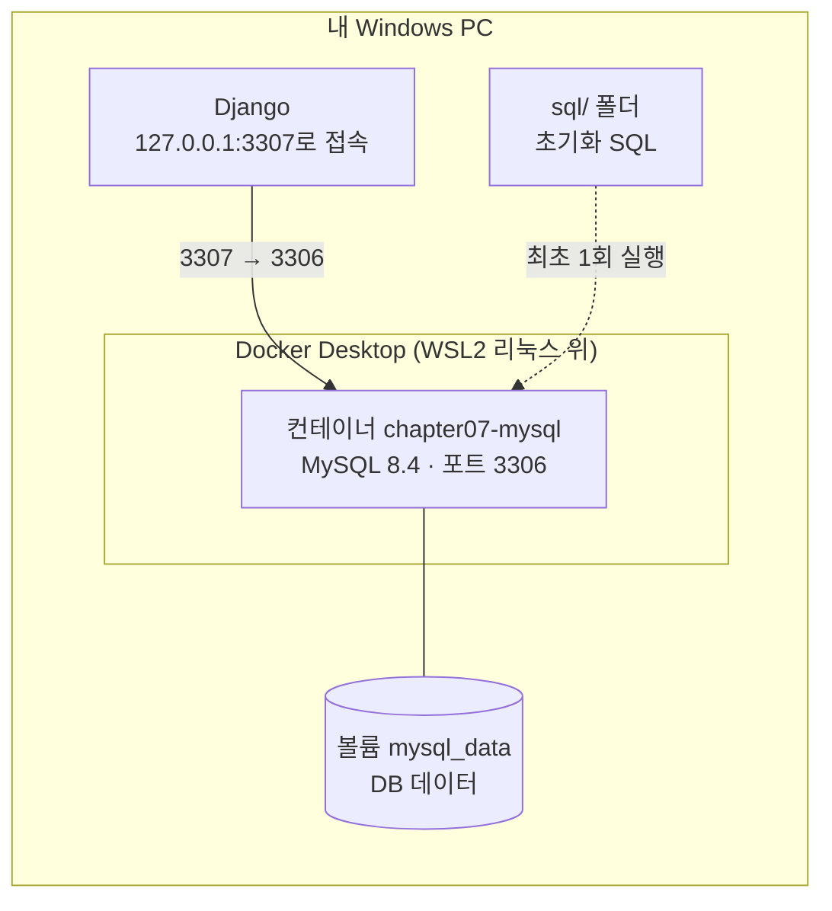
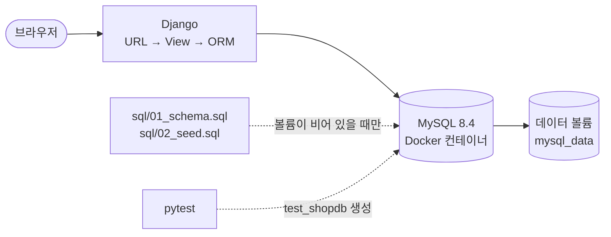

# 제7장 풀이노트 · Docker · MySQL 설치 및 SQL 기초

6장까지는 SQLite(파일 하나짜리 DB)를 썼습니다. 7장은 실무에서 쓰는 **MySQL 8.4**를 **Docker 컨테이너**로 띄우고, SQL로 직접 다뤄 본 뒤, Django ORM으로 연결합니다.

## 1. Docker가 뭔가

**Docker는 프로그램을 "그 프로그램이 돌아가는 데 필요한 모든 것과 함께" 상자에 담아서 어디서든 똑같이 실행하게 해 주는 도구**입니다.

### 비유: 이삿짐 컨테이너
- MySQL을 Windows에 **직접 설치**하면: 설치 마법사, 서비스 등록, 버전 충돌, 지울 때 찌꺼기… PC마다 결과가 조금씩 다릅니다.
- Docker로 실행하면: MySQL 8.4가 **이미 설치·설정된 상자(이미지)** 를 받아서 그대로 켭니다. 내 PC든 강사 PC든 서버든 똑같이 동작하고, 필요 없으면 상자째 버리면 끝입니다.

### 용어 4개만 알면 된다

| 용어 | 비유 | 7장에서 |
|---|---|---|
| **이미지** | 설치가 끝난 프로그램의 "설계도/붕어빵 틀" | `mysql:8.4` (Docker Hub에서 내려받음) |
| **컨테이너** | 이미지로 찍어 낸 "실행 중인 붕어빵" | `chapter07-mysql` |
| **볼륨** | 컨테이너를 버려도 남는 "외장 하드" | `mysql_data` (DB 데이터 보관) |
| **포트 연결** | 상자 벽에 뚫은 "창구" | Windows 3307 ↔ 컨테이너 3306 |



### 가상머신(VM)과 뭐가 다른가
VM은 운영체제를 통째로 하나 더 띄워서 무겁고 느립니다. 컨테이너는 **운영체제 핵심(커널)은 같이 쓰고 프로그램만 격리**해서 몇 초 만에 켜지고 가볍습니다. Windows에서는 Docker Desktop이 WSL2라는 작은 리눅스를 깔고 그 위에서 리눅스 컨테이너를 돌립니다.

### 왜 수업에서 Docker로 MySQL을 쓰나
- 설치·삭제가 깔끔하다 (`docker compose up -d` / `down`)
- 수강생 모두 **같은 버전, 같은 설정**
- 실무 배포도 대부분 컨테이너로 한다
- 설정이 `compose.yaml` 파일 하나에 다 적혀 있어서 Git으로 공유된다

## 2. 전체 구조



**테이블이 두 종류**라는 게 헷갈리기 쉽습니다.

| 테이블 | 만드는 곳 | 용도 |
|---|---|---|
| `practice_products` | `sql/01_schema.sql` (SQL 직접 작성) | SQL 문법 연습용 |
| `shop_product` | Django `migrate` (models.py에서 생성) | 웹 화면이 실제로 쓰는 테이블 |

## 3. compose.yaml 풀이

```yaml
services:
  mysql:
    image: mysql:8.4                           # 어떤 이미지로
    container_name: chapter07-mysql            # 컨테이너 이름
    restart: unless-stopped                    # 꺼지면 자동 재시작 (직접 끈 경우 제외)
    environment:
      MYSQL_DATABASE: ${MYSQL_DATABASE:?Set MYSQL_DATABASE in .env}   # .env에서 읽고, 없으면 실행 중단
      ...
    ports:
      - "127.0.0.1:${MYSQL_PORT:-3307}:3306"   # 내 PC에서만, 3307 → 컨테이너 3306
    volumes:
      - mysql_data:/var/lib/mysql              # 데이터는 볼륨에
      - ./sql:/docker-entrypoint-initdb.d:ro   # 초기화 SQL (읽기 전용)
    healthcheck:                               # 10초마다 mysqladmin ping
volumes:
  mysql_data:
```

| 문법 | 뜻 |
|---|---|
| `${VAR:?메시지}` | .env에 값이 없으면 메시지를 띄우고 멈춤 |
| `${VAR:-기본값}` | 값이 없으면 기본값 사용 |
| `127.0.0.1:3307:3306` | 다른 PC에서는 접속 못 하게 내 PC로만 열기. 3306 대신 3307을 쓰는 건 PC에 이미 MySQL이 있어도 충돌하지 않게 하려는 것 |
| `$$MYSQL_PASSWORD` | `$` 두 개 = Compose가 미리 바꾸지 말고 컨테이너 안에서 해석하라는 뜻 |
| `:ro` | read-only, 컨테이너가 sql 폴더를 고치지 못함 |

> **주의:** `sql/` 초기화 스크립트와 `MYSQL_USER` 등 계정 설정은 **볼륨이 비어 있는 첫 실행에만** 적용됩니다. 나중에 .env 비밀번호를 바꿔도 이미 만들어진 DB에는 반영되지 않습니다(그래서 생기는 오류가 "Access denied"). 완전히 처음부터 하려면 `docker compose down -v`로 볼륨까지 지웁니다(데이터 삭제됨).

## 4. Docker 명령

| 명령 | 하는 일 |
|---|---|
| `docker compose config` | compose.yaml과 .env를 합친 최종 설정 확인 (오타 검사) |
| `docker compose up -d` | 컨테이너를 백그라운드로 실행 (처음엔 이미지 다운로드) |
| `docker compose ps` | 상태 확인, `healthy`가 나와야 준비 완료 |
| `docker compose logs mysql` | MySQL 로그 보기 |
| `docker compose exec mysql …` | 컨테이너 안에서 명령 실행 |
| `docker compose down` | 컨테이너 중지·삭제 (볼륨=데이터는 유지) |
| `docker compose down -v` | 볼륨까지 삭제 (데이터 초기화) |

## 5. SQL 기초 (CRUD)

```sql
-- R 조회
SELECT id, name, price, stock FROM practice_products ORDER BY price DESC;
SELECT name, price FROM practice_products WHERE price < 100000;
-- C 등록
INSERT INTO practice_products (name, price, stock) VALUES ('모니터', 220000, 8);
-- U 수정
UPDATE practice_products SET stock = stock - 1 WHERE name = '마우스' AND stock > 0;
-- D 삭제
DELETE FROM practice_products WHERE name = '모니터';
-- 집계
SELECT COUNT(*) AS product_count, SUM(stock) AS total_stock FROM practice_products;
```

| 키워드 | 뜻 | 2~3장 파이썬으로 치면 |
|---|---|---|
| `SELECT … FROM` | 어떤 열을 어디서 | 리스트에서 꺼내기 |
| `WHERE` | 조건에 맞는 행만 | `if` 필터, 리스트 컴프리헨션 |
| `ORDER BY … DESC` | 정렬 (내림차순) | `sorted(..., reverse=True)` |
| `INSERT INTO` | 행 추가 | `append` |
| `UPDATE … SET` | 값 수정 | `product["stock"] -= 1` |
| `DELETE FROM` | 행 삭제 | `remove` |
| `COUNT`, `SUM` | 집계 | `len`, `sum` |

> `UPDATE`와 `DELETE`에 **WHERE를 빼면 테이블 전체**가 바뀌거나 지워집니다. 항상 WHERE부터 확인합니다.

`01_schema.sql`의 `CHECK (price >= 0)`, `CHECK (stock >= 0)`는 DB 자체가 음수를 거부하게 만듭니다. 2장에서 파이썬 코드로 하던 검사를 DB가 한 번 더 해 주는 셈입니다.

## 6. Django를 MySQL에 연결

```python
DATABASES = {"default": {
    "ENGINE": "django.db.backends.mysql",           # SQLite → MySQL
    "NAME": os.environ.get("MYSQL_DATABASE", "shopdb"),
    "USER": os.environ.get("MYSQL_USER", "shopuser"),
    "PASSWORD": os.environ.get("MYSQL_PASSWORD", ""),
    "HOST": os.environ.get("MYSQL_HOST", "127.0.0.1"),
    "PORT": os.environ.get("MYSQL_PORT", "3307"),
    "OPTIONS": {"charset": "utf8mb4"},               # 한글·이모지
    "TEST": {"NAME": "test_" + os.environ.get("MYSQL_DATABASE", "shopdb")},
}}
```
- `mysqlclient`: Django가 MySQL과 대화할 때 쓰는 드라이버입니다. Windows Python 3.12용 설치 파일이 있어서 `uv add`만으로 설치됐습니다.
- 접속 정보는 전부 `.env`에서 읽습니다. compose.yaml도 같은 `.env`를 읽으니 **값을 한 곳에서만 관리**합니다.

### 모델과 ORM
```python
class Product(models.Model):
    name = models.CharField(max_length=100)
    price = models.PositiveIntegerField()        # 음수 불가
    stock = models.PositiveIntegerField(default=0)
    class Meta:
        ordering = ["id"]                        # 기본 정렬
```

| ORM (파이썬) | SQL |
|---|---|
| `Product.objects.all()` | `SELECT * FROM shop_product ORDER BY id` |
| `Product.objects.filter(price__lt=100000)` | `… WHERE price < 100000` |
| `Product.objects.filter(stock__gt=0).count()` | `SELECT COUNT(*) … WHERE stock > 0` |
| `Product.objects.order_by("-price").first()` | `… ORDER BY price DESC LIMIT 1` |
| `Product.objects.update_or_create(name=…, defaults=…)` | 있으면 UPDATE, 없으면 INSERT |

`__lt`(less than), `__gt`(greater than)처럼 **밑줄 두 개**로 조건을 붙입니다. ORM 덕분에 DB가 SQLite든 MySQL이든 파이썬 코드는 그대로입니다.

### 마이그레이션
```powershell
uv run python manage.py makemigrations shop   # models.py → shop/migrations/0001_initial.py (설계도)
uv run python manage.py migrate               # 설계도대로 MySQL에 테이블 생성
```

### 관리자 페이지
`shop/admin.py`에 `@admin.register(Product)`로 등록하면 `/admin/`에서 상품을 추가·수정할 수 있습니다. 로그인하려면 `uv run python manage.py createsuperuser`로 관리자 계정을 먼저 만듭니다.

## 7. 실행 순서

```powershell
uv sync
Copy-Item .env.example .env              # 비밀번호·비밀키 변경
docker compose up -d
docker compose ps                        # healthy 확인
uv run python manage.py migrate
uv run python -m scripts.seed_products   # 노트북·마우스·키보드 등록
uv run python manage.py runserver 127.0.0.1:8000
uv run pytest -v                         # 다른 창에서
uv run python -m exercises.solutions
```

## 8. 제 PC에서 확인한 것과 못 한 것

이 PC에는 아직 Docker Desktop이 설치되어 있지 않아서, **MySQL을 실제로 띄우는 부분은 확인하지 못했습니다.**

| 항목 | 상태 |
|---|---|
| `uv add` (django, mysqlclient, dotenv, pytest) | ✅ 설치됨, mysqlclient 2.3.0 |
| `manage.py check` | ✅ no issues |
| `makemigrations shop` | ✅ 교재 단계 22와 같은 0001_initial.py 생성 |
| 모델·화면·테스트·시드·과제 코드 | ✅ DB만 SQLite로 바꾼 임시 설정으로 확인: pytest 4 passed, 상품 3개 등록, 과제 출력 정상 |
| `docker compose up`, SQL 실습, MySQL 위 pytest | ⏳ Docker Desktop 설치 후 확인 필요 |

## 9. 교재와 다르게 한 곳

| 내용 | 이유 |
|---|---|
| `settings.py`에 `STATICFILES_DIRS = [BASE_DIR / "static"]` 추가 | 7장은 CSS를 앱 폴더가 아닌 **프로젝트 루트** `static/shop/style.css`에 둡니다. 교재 설정만으로는 Django가 이 폴더를 몰라서 `findstatic`이 "No matching file found"를 냄 (직접 확인) → 화면에 CSS가 안 입혀짐 |

## 10. 주요 오류와 해결

| 증상 | 해결 |
|---|---|
| `docker compose up -d` 실패 | Docker Desktop을 먼저 실행하고 Linux 컨테이너 모드인지 확인 |
| 3307 포트 사용 중 | .env의 `MYSQL_PORT`를 다른 포트로 (Django도 같은 값을 읽음) |
| Access denied | .env 비밀번호와 볼륨에 처음 저장된 계정 정보가 다름 → DB 안에서 비밀번호 변경 또는 `down -v` 후 재초기화 |
| 테스트 DB 생성 권한 없음 | MySQL 앱 계정에 `test_shopdb` 생성 권한 부여 (docker 이미지는 `MYSQL_USER`에게 `shopdb` 권한만 줌) |
| SQL 초기화 파일이 실행 안 됨 | 빈 볼륨의 첫 실행에만 적용 → 기존 볼륨에서는 수동 실행 |
| mysqlclient 설치 실패 | Python 3.12와 호환 wheel 확인 |

## 11. 확인 문제

<details><summary>Docker 볼륨을 쓰는 이유는?</summary>

컨테이너를 종료하거나 다시 만들어도 MySQL 데이터를 유지하기 위해서입니다.
</details>

<details><summary>Django DATABASES의 ENGINE 값은?</summary>

`django.db.backends.mysql`입니다.
</details>

<details><summary>WHERE, UPDATE, DELETE의 역할은?</summary>

WHERE는 행을 걸러내고, UPDATE는 데이터를 수정하며, DELETE는 행을 삭제합니다.
</details>

<details><summary>SQL 초기화 테이블과 Django Product 테이블의 차이는?</summary>

practice_products는 SQL 연습용이고, shop_product는 Django 마이그레이션으로 생성되는 ORM 테이블입니다.
</details>

<details><summary>pytest-django가 필요한 이유는?</summary>

Django 설정, 테스트 DB, 테스트 클라이언트 같은 통합 테스트 기능을 제공하기 때문입니다.
</details>

<details><summary>이미지와 컨테이너의 차이는?</summary>

이미지는 실행 준비가 끝난 틀(읽기 전용)이고, 컨테이너는 그 이미지로 실제 실행 중인 인스턴스입니다. 이미지 하나로 컨테이너를 여러 개 만들 수 있습니다.
</details>
